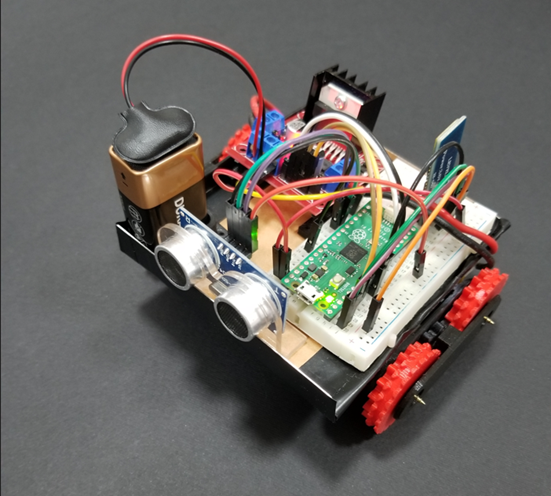
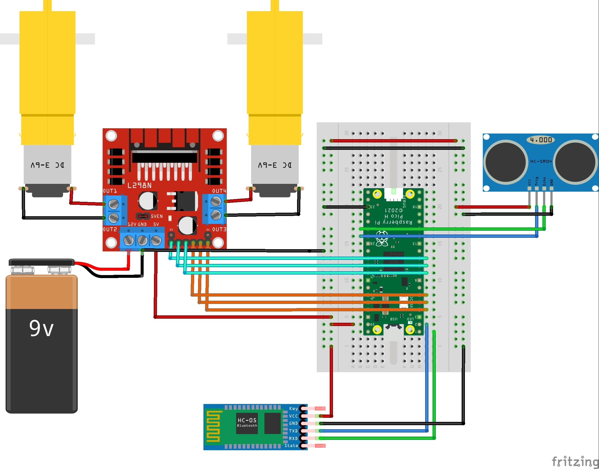
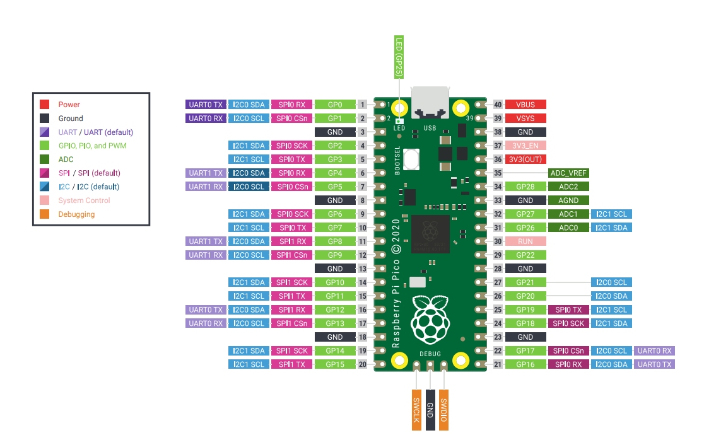
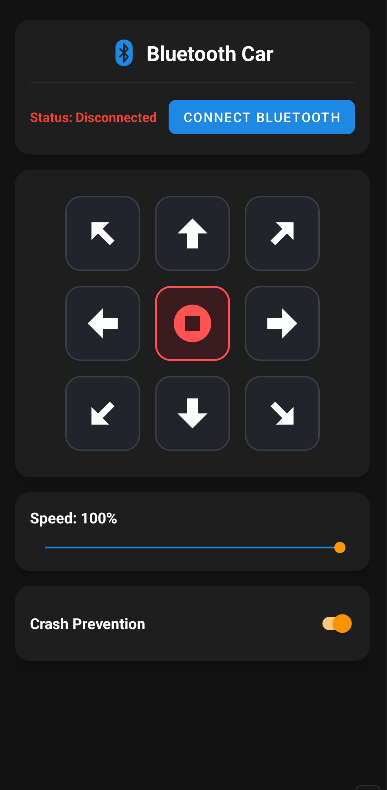

  

  <h1 align="center">Bluetooth Controlled Car with Raspberry Pi Pico</h1>
  

# About The Project

This project involves controlling a car using UART communication and an ultrasonic sensor with a Raspberry Pi Pico. The car can move in all directions and stop based on commands received via the UART channel over Bluetooth. Additionally, the car is equipped with a crash prevention feature using an ultrasonic sensor to detect obstacles in front of the robot. If the crash prevention feature is enabled and the car is about to collide with an obstacle, the robot will automatically stop. The car also has a function to measure the distance to an obstacle using the ultrasonic sensor.

### Components Used

- **Raspberry Pi Pico**
- **Bluetooth Module (UART)**
- **Ultrasonic Sensor (HC-SR04)**
- **DC Motors**
- **Motor Driver (L298N)**
- **LED Indicator**

(<a href="#readme-top">back to top</a>)

## Wiring Diagram

The wiring diagram illustrates how the Raspberry Pi Pico is connected to the DC motors, ultrasonic sensor, and other components. Ensure correct connections for the proper functioning of the car control system.

  

| Pin        | Function  |
| ---------- | --------- |
| GPIO6      | IN1       |
| GPIO7      | IN2       |
| GPIO8      | EN_A      |
| GPIO4      | IN3       |
| GPIO3      | IN4       |
| GPIO2      | EN_B      |
| GPIO21     | Trigger   |
| GPIO20     | Echo      |
| GPIO25     | LED       |
| GPIO1 (TX) | RX (HC05) |
| GPIO2 (RX) | TX (HC05) |

(<a href="#readme-top">back to top</a>)

## Raspberry Pi Pico Pinout

Refer to the Raspberry Pi Pico pinout diagram to identify the GPIO pins used for connecting the various components.

  

---

## Android Control App

A prebuilt APK is available for download: [Bluetooth_Car.apk](/releases/Bluetooth_Car.apk).

If you'd like to customize the app, explore the source code, or build your own APK, follow the [Android README](/android/README.md) for setup instructions and build steps.

### App Preview

  

---

## 3D Printable Wheels

If you'd like to enhance the aesthetics or functionality of your car, you can 3D print custom wheels. STL files for the wheels are provided in the `assets/hardware/cad/` directory.

Feel free to customize the code for additional features or optimizations. Happy driving!

(<a href="#readme-top">back to top</a>)

